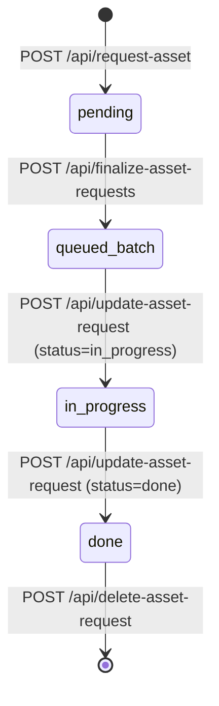

# Homesteader Asset Kit Server — API Reference & Contract Specification

The Homesteader Asset Kit backend is served by [`assets/server.py`](server.py) (default `http://localhost:8000`). It provides a RESTful interface over the decentralized asset filesystem (`assets/<category>/<item_id>/`), request queue (`assets/_asset_requests/`), schema definitions (`assets/_schemas/`), and catalog cache.

This document serves as the authoritative API specification for developers and AI agents (Gemini, Claude, Antigravity, Cursor) interacting with the asset kit.

---

## Table of Contents

1. [Lifecycle & State Architecture](#1-lifecycle--state-architecture)
2. [Asset Requests & Queue Pipeline](#2-asset-requests--queue-pipeline)
3. [Catalog & Inspection Endpoints](#3-catalog--inspection-endpoints)
4. [Manifest & Asset Mutations](#4-manifest--asset-mutations)
5. [Taxonomy, Tags & Schemas](#5-taxonomy-tags--schemas)
6. [Spend Approvals & Balances](#6-spend-approvals--balances)
7. [Icon & Generator Operations](#7-icon--generator-operations)
8. [Python & cURL Code Snippets](#8-python--curl-code-snippets)

---

## 1. Lifecycle & State Architecture

### Queue Directory State Machine



- **`assets/_asset_requests/pending/`**: Newly submitted requests (`{id}.json`). Sits untouched until finalized.
- **`assets/_asset_requests/batches/`**: Finalized batches (`batch_{timestamp}.json`) grouping pending requests for collective generation.
- **`assets/_asset_requests/in_progress/`**: Active items being generated or rigged.
- **`assets/_asset_requests/done/`**: Completed requests with `completed_at` timestamp and `created_item_id`.
- **`assets/_asset_requests/watcher_heartbeat.json`**: Liveness timestamp updated by `watch_asset_requests.py`.

---

## 2. Asset Requests & Queue Pipeline

### `GET /api/asset-requests`

Lists all queued asset requests across `pending`, `in_progress`, and `done` states.

- **Query Parameters**: None
- **Response**: `200 OK`

```json
{
	"success": true,
	"requests": [
		{
			"id": "1789520000_steel_stud_framing",
			"name": "Steel Stud (Metal Framing)",
			"category": "building",
			"description": "...",
			"status": "done",
			"requested_at": "2026-09-16T00:00:00Z",
			"completed_at": "2026-09-17T13:48:11Z",
			"step": "Complete: ...",
			"created_item_id": "mat_steel_stud_framing",
			"credits_used": { "creative_claw": 0, "meshy": 0 }
		}
	]
}
```

---

### `POST /api/request-asset`

Queues a new single-item generation request in `pending/`.

- **Request Body**:

```json
{
	"name": "Steel Framing Stud",
	"category": "building",
	"description": "Galvanized C-stud bundle for metal walls.",
	"notes": "Optional notes or recipe hints",
	"also_rig": false,
	"rig_type": "human",
	"no_model": false,
	"pipeline": "free",
	"reference_category": "building",
	"reference_item_id": "lumber_stud_2x4",
	"schema": "building_material"
}
```

- **Response**: `200 OK` `{"success": true, "id": "1789520000_steel_framing_stud"}`

---

### `POST /api/request-asset-stages`

Queues a 4-stage linked lifecycle set (e.g. crop seed $\rightarrow$ sprout $\rightarrow$ growing $\rightarrow$ mature, or building construction phases).

- **Request Body**:

```json
{
	"name": "Corn",
	"category": "farming",
	"description": "Sweet field corn plant.",
	"growth_type": "crop",
	"max_age": 14,
	"time_unit": "days",
	"pipeline": "free",
	"stages": [
		{ "stage": 1, "name": "Corn Seeds", "age_min": 0, "age_max": 2 },
		{ "stage": 2, "name": "Corn Sprout", "age_min": 2, "age_max": 5 },
		{ "stage": 3, "name": "Corn Growing", "age_min": 5, "age_max": 10 },
		{ "stage": 4, "name": "Corn Mature", "age_min": 10, "age_max": 14 }
	]
}
```

- **Response**: `200 OK` `{"success": true, "group_id": "corn", "stage_request_ids": [...]}`

---

### `POST /api/finalize-asset-requests`

Moves all currently `pending` requests into a single grouped batch file in `assets/_asset_requests/batches/batch_{timestamp}.json` and triggers `watch_asset_requests.py`.

- **Request Body**: `{}` (Empty JSON)
- **Response**: `200 OK` `{"success": true, "batch_id": "batch_1789651222", "item_count": 3}`

---

### `POST /api/update-asset-request`

Updates progress, records credit consumption, and advances request state.

- **Request Body**:

```json
{
	"id": "1789520000_steel_stud_framing",
	"status": "done",
	"step": "Complete: 3D model and 128x128 icon created",
	"item_id": "mat_steel_stud_framing",
	"credits_used": { "creative_claw": 0, "meshy": 0 }
}
```

- **Status Values**: `"pending"`, `"in_progress"`, `"done"`.
- **Side Effect**:
  - If `"in_progress"`: Moves file to `assets/_asset_requests/in_progress/{id}.json`.
  - If `"done"`: Sets `completed_at`, moves file to `assets/_asset_requests/done/{id}.json`, and triggers auto-creation of growth groups if linked.
- **Response**: `200 OK` `{"success": true, "request": {...}}`

---

### `POST /api/delete-asset-request`

Removes an individual request record from the queue (from any folder: `pending`, `in_progress`, or `done`). Does not touch actual item assets.

- **Request Body**: `{"id": "1789520000_steel_stud_framing"}`
- **Response**: `200 OK` `{"success": true, "deleted_id": "..."}`

---

### `POST /api/delete-all-asset-requests`

Clears requests in bulk.

- **Request Body**:
  - `{"scope": "all"}`: Deletes all requests across `pending`, `in_progress`, and `done`.
  - `{"scope": "done"}`: Deletes only completed requests, leaving active ones.
- **Response**: `200 OK` `{"success": true, "deleted_count": 3}`

---

## 3. Catalog & Inspection Endpoints

### `GET /api/catalog`

Returns the entire unified catalog (600+ items across all 16 categories), read directly from each item's `<item_id>.json` on disk.

- **Response**: `200 OK`

```json
{
  "categories": ["structures", "building", "farming", ...],
  "items": {
    "building": [
      {
        "id": "mat_steel_stud_framing",
        "name": "Steel Stud (Metal Framing)",
        "category": "building",
        "icon": "building/mat_steel_stud_framing/mat_steel_stud_framing.png",
        "has_model": true,
        "properties": {...}
      }
    ]
  },
  "total_items": 600
}
```

---

### `GET /api/catalog-entry?category={category}&id={id}`

Returns the freshly-built catalog entry and manifest for a specific item.

- **Response**: `200 OK` `{"success": true, "entry": {...}, "manifest": {...}}`

---

### `GET /api/item-files?category={category}&id={id}`

Lists every file physically present inside the item's directory on disk (`.obj`, `.glb`, `.fbx`, `.png`, `.json`, etc.) with file sizes and timestamps.

- **Response**: `200 OK`

```json
{
	"success": true,
	"files": [
		{ "name": "mat_steel_stud_framing.glb", "size": 13888, "ext": ".glb" },
		{ "name": "mat_steel_stud_framing.png", "size": 5025, "ext": ".png" }
	]
}
```

---

### `GET /api/ghost-entries`

Detects entries lingering in the catalog cache or index that no longer exist on disk.

- **Response**: `200 OK` `{"ghost_entries": [{"category": "tools", "id": "tool_old"}]}`

### `POST /api/delete-ghost-entries`

Prunes identified ghost entries from the cache.

- **Request Body**: `{"entries": [{"category": "tools", "id": "tool_old"}]}`
- **Response**: `200 OK` `{"success": true, "pruned": 1}`

---

## 4. Manifest & Asset Mutations

### `POST /api/save-manifest`

Freeform manifest updater. Writes directly to `assets/<category>/<item_id>/<item_id>.json`.

- **Request Body**:

```json
{
  "category": "building",
  "item_id": "mat_steel_stud_framing",
  "manifest": { ...complete json object... }
}
```

- **Response**: `200 OK` `{"success": true, "item_id": "mat_steel_stud_framing"}`

---

### `POST /api/rename-asset`

Renames an asset ID, updates folder name, `<item_id>.json`, `<item_id>.png`, model references, and any growth chain stage links.

- **Request Body**:

```json
{
	"category": "building",
	"old_id": "old_steel_stud",
	"new_id": "mat_steel_stud_framing",
	"new_name": "Steel Stud (Metal Framing)"
}
```

- **Response**: `200 OK` `{"success": true, "old_id": "...", "new_id": "..."}`

---

### `POST /api/move-asset`

Moves an asset from one category folder to another. If the target category enforces prefixes (e.g. moving from `tools` to `materials`), it automatically adapts the prefix.

- **Request Body**:

```json
{
	"category": "tools",
	"item_id": "item_gravel_pile",
	"target_category": "materials"
}
```

- **Response**: `200 OK` `{"success": true, "old_id": "...", "new_id": "mat_pile_gravel"}`

---

### `POST /api/delete-asset`

Permanently deletes an item folder from disk (`assets/<category>/<item_id>/`), removes it from the catalog, and updates `README.md`.

- **Request Body**: `{"category": "building", "item_id": "temp_item"}`
- **Response**: `200 OK` `{"success": true, "message": "Asset 'temp_item' was permanently deleted."}`

---

## 5. Taxonomy, Tags & Schemas

### `GET /api/material-tags`

Reads [`assets/_schemas/material_tags.json`](_schemas/material_tags.json).

- **Response**: `200 OK`

```json
{
	"tags": {
		"steel_framing": ["mat_steel_stud_framing", "mat_steel_frame_beam"],
		"metal_siding": ["mat_steel_siding_corrugated"]
	}
}
```

### `POST /api/save-material-tag`

Creates or updates (full replace) one recipe material tag. Every member must be an existing catalog asset ID.

- **Request Body**:

```json
{
	"tag_name": "steel_framing",
	"members": ["mat_steel_stud_framing", "mat_steel_frame_beam"]
}
```

- **Response**: `200 OK` `{"success": true, "tag": "steel_framing"}`

---

### `GET /api/schemas`

Lists available JSON schema definitions in `assets/_schemas/` (e.g. `crop`, `livestock`, `structure`, `building_material`).

- **Response**: `200 OK` `{"schemas": ["crop", "structure", "tool", ...]}`

---

### `GET /api/growth-groups` & `POST /api/growth-groups`

Retrieves or saves 4-stage lifecycle groupings (e.g. `oak`, `corn`, `large_metal_garage`).

- **POST Request Body**:

```json
{
	"species": "large_metal_garage",
	"stages": [
		"struct_foundation_large_metal_garage",
		"struct_framing_large_metal_garage",
		"struct_walls_large_metal_garage",
		"struct_complete_large_metal_garage"
	]
}
```

---

## 6. Spend Approvals & Balances

Used for explicit user spending approval before any generation - **every request costs money now**, so the approval gate applies to all of them, not just items formerly marked `PIPELINE=paid`:

- `POST /api/request-approval`: Queues a user modal prompt with cost breakdown.
  - Body: `{"title": "...", "description": "...", "service": "meshy", "cost": 15}`
- `GET /api/pending-approvals`: Lists unanswered approval prompts.
- `GET /api/approval-status?id={id}`: Checks if user clicked Approve or Deny.
- `GET /api/creative-claw-balance`: Reads cached Creative Claw credit balance (retired service - kept for historical records).
- `POST /api/creative-claw-balance`: Updates Creative Claw balance. Body: `{"balance": 120}`.
- `GET /api/meshy-balance`: Returns current Meshy credit balance (**the one to check before every spend**).

---

## 7. Icon & Generator Operations

- `POST /api/regen-icon`: Re-triggers 2D icon generation for an existing asset using FLUX.
  - Body: `{"category": "building", "item_id": "mat_steel_frame_beam", "prompt": "..."}`
- `POST /api/open-item-folder`: Opens the Windows Explorer file browser at the item's directory.
  - Body: `{"category": "building", "item_id": "mat_steel_frame_beam"}`
- `GET /api/watcher-status`: Checks if `watch_asset_requests.py` is actively polling.
- `POST /api/invalidate-catalog-cache`: Clears server-side in-memory catalog cache so the next `GET /api/catalog` reads directly from disk.

---

## 8. Python & cURL Code Snippets

### Mark Request Done (Python)

```python
import urllib.request, json

payload = {
    "id": "1789520000_steel_stud_framing",
    "status": "done",
    "step": "Complete: 3D model and 128x128 icon created",
    "item_id": "mat_steel_stud_framing",
    "credits_used": {"creative_claw": 0, "meshy": 0}
}
req = urllib.request.Request(
    "http://localhost:8000/api/update-asset-request",
    data=json.dumps(payload).encode("utf-8"),
    headers={"Content-Type": "application/json"}
)
with urllib.request.urlopen(req) as resp:
    result = json.loads(resp.read().decode())
    print(result)
```

### Query Catalog Item (cURL)

```bash
curl -X GET "http://localhost:8000/api/catalog-entry?category=building&id=mat_steel_stud_framing"
```

### Save Material Tag (cURL)

```bash
curl -X POST "http://localhost:8000/api/save-material-tag" \
  -H "Content-Type: application/json" \
  -d '{"tag_name": "steel_framing", "members": ["mat_steel_stud_framing", "mat_steel_frame_beam"]}'
```
