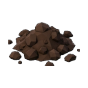

# Dirt Clump (`clutter_dirt_clump`)

## Overview
- **Category**: `ground`
- **Item Identifier**: `clutter_dirt_clump`
- **Max Stack Size**: 99
- **Weight**: 0.5 kg
- **Base Economic Value**: $0.5
- **Consumable**: False

## Description
A clump of topsoil and pebbles turned over by excavation.

## 3D Model & Mesh Specifications
- **Physical Dimensions**: *Model geometry dynamically procedural or referenced via sub-mesh components.*
- **Shading Aesthetic**: 3D Low-Poly Faceted, Metric Scale (cm), Ground-Aligned Pivot ($Z_{min} = 0$).
- **Texture / Materials**: Flat-shaded UV mapped to `T_Homesteader_Palette` or dedicated 512×512 PBR.

## Utilities & Resource Profile
| Utility System | Usage / Output Metric | Operational Details |
| :--- | :--- | :--- |
| **💧 Water** | `None (unplumbed / dry)` | None (unplumbed / dry) |
| **⚡ Electricity** | `None (passive / unpowered)` | None (passive / unpowered) |
| **🚽 Sewage / Waste** | `None (no waste discharge)` | None (no waste discharge) |
| **🔋 Battery Power** | `None (no internal battery)` | None (no internal battery) |
| **🌐 Internet / Data** | `None (offline / non-networked)` | None (offline / non-networked) |

## Asset Files & Links
- **Plugin Manifest (JSON)**: [clutter_dirt_clump.json](clutter_dirt_clump.json)
- **Icon (PNG)**: [clutter_dirt_clump.png](clutter_dirt_clump.png)
