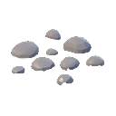

# Pebbles (`clutter_pebbles`)

## Overview
- **Category**: `ground`
- **Item Identifier**: `clutter_pebbles`
- **Max Stack Size**: 20
- **Weight**: 0.5 kg
- **Base Economic Value**: $0.0
- **Consumable**: False

## Description
A scattered cluster of small pebbles.

## 3D Model & Mesh Specifications
- **Physical Dimensions (X × Y × Z)**: `1.9 cm × 1.0 cm × 0.3 cm` (`0.02m × 0.01m × 0.0m`)
- **Mesh Complexity**: 132505 vertices, 265049 polygon faces
- **Bounding Box**: $X_{min}=-0.950626$, $X_{max}=0.948686$, $Y_{min}=-0.499147$, $Y_{max}=0.497277$, $Z_{min}=-0.1305$, $Z_{max}=0.128755$
- **Shading Aesthetic**: 3D Low-Poly Faceted, Metric Scale (cm), Ground-Aligned Pivot ($Z_{min} = 0$).
- **Texture / Materials**: Flat-shaded UV mapped to `T_Homesteader_Palette` or dedicated 512×512 PBR.

## Utilities & Resource Profile
| Utility System | Usage / Output Metric | Operational Details |
| :--- | :--- | :--- |
| **💧 Water** | `None (unplumbed / dry)` | None (unplumbed / dry) |
| **⚡ Electricity** | `None (passive / unpowered)` | None (passive / unpowered) |
| **🚽 Sewage / Waste** | `None (no waste discharge)` | None (no waste discharge) |
| **🔋 Battery Power** | `None (no internal battery)` | None (no internal battery) |
| **🌐 Internet / Data** | `None (offline / non-networked)` | None (offline / non-networked) |

## Asset Files & Links
- **Plugin Manifest (JSON)**: [clutter_pebbles.json](clutter_pebbles.json)
- **Icon (PNG)**: [clutter_pebbles.png](clutter_pebbles.png)
- **3D Mesh (FBX)**: [SM_Clutter_Pebbles.fbx](SM_Clutter_Pebbles.fbx)
- **3D Mesh (MTL)**: [SM_Clutter_Pebbles.mtl](SM_Clutter_Pebbles.mtl)
- **3D Mesh (OBJ)**: [SM_Clutter_Pebbles.obj](SM_Clutter_Pebbles.obj)
