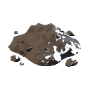

# Pinecones (`clutter_pinecones`)

## Overview
- **Category**: `ground`
- **Item Identifier**: `clutter_pinecones`
- **Max Stack Size**: 20
- **Weight**: 0.2 kg
- **Base Economic Value**: $0.0
- **Consumable**: False

## Description
A pair of fallen pinecones.

## 3D Model & Mesh Specifications
- **Physical Dimensions (X × Y × Z)**: `1.9 cm × 1.4 cm × 1.9 cm` (`0.02m × 0.01m × 0.02m`)
- **Mesh Complexity**: 863534 vertices, 1727813 polygon faces
- **Bounding Box**: $X_{min}=-0.930395$, $X_{max}=0.921322$, $Y_{min}=-0.680741$, $Y_{max}=0.674688$, $Z_{min}=-0.947297$, $Z_{max}=0.948613$
- **Shading Aesthetic**: 3D Low-Poly Faceted, Metric Scale (cm), Ground-Aligned Pivot ($Z_{min} = 0$).
- **Texture / Materials**: Flat-shaded UV mapped to `T_Homesteader_Palette` or dedicated 512×512 PBR.

## Utilities & Resource Profile
| Utility System | Usage / Output Metric | Operational Details |
| :--- | :--- | :--- |
| **💧 Water** | `None (unplumbed / dry)` | None (unplumbed / dry) |
| **⚡ Electricity** | `None (passive / unpowered)` | None (passive / unpowered) |
| **🚽 Sewage / Waste** | `None (no waste discharge)` | None (no waste discharge) |
| **🔋 Battery Power** | `None (no internal battery)` | None (no internal battery) |
| **🌐 Internet / Data** | `None (offline / non-networked)` | None (offline / non-networked) |

## Asset Files & Links
- **Plugin Manifest (JSON)**: [clutter_pinecones.json](clutter_pinecones.json)
- **Icon (PNG)**: [clutter_pinecones.png](clutter_pinecones.png)
- **3D Mesh (FBX)**: [SM_Clutter_Pinecones.fbx](SM_Clutter_Pinecones.fbx)
- **3D Mesh (MTL)**: [SM_Clutter_Pinecones.mtl](SM_Clutter_Pinecones.mtl)
- **3D Mesh (OBJ)**: [SM_Clutter_Pinecones.obj](SM_Clutter_Pinecones.obj)
