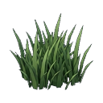

# Medium Grass (`ground_medium_grass`)

## Overview
- **Category**: `ground`
- **Item Identifier**: `ground_medium_grass`
- **Max Stack Size**: 99
- **Weight**: 1 kg
- **Base Economic Value**: $10
- **Consumable**: False

## Description
A 1m x 1m patch of medium-height grass.

## 3D Model
- **Dimensions (m)**: `1 x 1 x 0.1`
- **Scale**: metric, 1 unit = 1 m. Ground-level pivot for placed things, centred pivot for handheld ones.

## Properties
- **Happiness modifier**: `0`
- **Thirst restore**: `0`
- **Energy restore**: `0`
- **Stamina restore**: `0`
- **Wellness modifier**: `0`

## Utilities
| Utility System | Usage / Output Metric | Operational Details |
| :--- | :--- | :--- |
| **Water** | `None (unplumbed / dry)` | None (unplumbed / dry) |
| **Electricity** | `None (passive / unpowered)` | None (passive / unpowered) |
| **Sewage / Waste** | `None (no waste discharge)` | None (no waste discharge) |
| **Battery Power** | `None (no internal battery)` | None (no internal battery) |
| **Internet / Data** | `None (offline / non-networked)` | None (offline / non-networked) |

## Asset Files
- **Plugin Manifest (JSON)**: [ground_medium_grass.json](ground_medium_grass.json)
- **Icon (PNG)**: [ground_medium_grass.png](ground_medium_grass.png)
