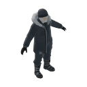

# Winter Farmer (`peds_farmer_winter`)

## Overview
- **Category**: `peds`
- **Item Identifier**: `peds_farmer_winter`
- **Weight**: 78.0 kg
- **Consumable**: False

## Description
An older male farmer in modern winter work gear - navy beanie, fur-trimmed insulated parka, work gloves, insulated trousers and buckled snow boots; grey stubble beard. Winter variant of a four-season farmer set (spring, summer, autumn, winter share one character design).

## Generation Pipeline
- **Reference image**: external image generator, four-season A-pose sheet (front-on, arms angled off the torso), split into one image per season.
- **3D Model + Texture**: Meshy image-to-3D, `model_type='smart-topology'` (`ai_model='meshy-t2'`), `pose_mode='a-pose'`, textured.
- **Rigging**: Meshy AI rigging (`meshy_rig`), 1.7m height, 24-joint Mixamo-named skeleton, includes free Walk and Run clips.
- **Farm animations**: retargeted in Mesh2Motion ("Use Your Rigged Model" page): the Meshy rig was loaded, bones auto-mapped (Mixamo names), then six library clips exported as GLB with Mixamo bone naming.
- **Cost**: 20 Meshy credits (15 mesh/texture + 5 rig+animations). Reference image was generated outside Meshy.

## 3D Model & Mesh Specifications
- **Rest Pose**: A-pose.
- **Rig**: 24 joints, humanoid; 22 of 24 joints own vertices in the rigged mesh.
- **Format**: GLB throughout (textures embedded), for runtime loading through the modding tools.
- **Shading Aesthetic**: 3D Low-Poly Faceted, metric scale, ~1.7m height.
- **Icon**: rendered from the unrigged base model via `tools/render_icon_from_model.py`.

## Animations
| File | Clips |
| :--- | :--- |
| `peds_farmer_winter_walk.glb` | walking (Meshy) |
| `peds_farmer_winter_run.glb` | running (Meshy) |
| `peds_farmer_winter_farm_anims.glb` | `Chop_Tree_RT`, `Farm_Harvest_RT`, `Farm_PlantSeed_RT`, `Farm_Watering_RT`, `Idle_A_RT`, `Sleeping_RT` (Mesh2Motion) |
| `peds_farmer_winter_extra_anims.glb` | `Walk_Carry_RT`, `Fixing_Kneeling_RT`, `Crouch_Idle_RT`, `Push_RT` (Mesh2Motion) |
| `peds_farmer_winter_work_anims.glb` | `Dig`, `Hoe`, `Pet` (full body), `Drag` (upper body) (Blender, IK-posed) |
| `peds_farmer_winter_hold.glb` | `Hold_Lantern`, `Hold_Flashlight` (Blender, right arm only, layered over locomotion) |

Arm clearance was verified numerically: hands stay 0.43-0.84 torso-lengths from the spine axis in every clip (same range as Meshy's own walk/run). An earlier export had hands at 0.02-0.28, i.e. inside the torso, because Mesh2Motion assumed a T-pose target (see `docs/MESH2MOTION_SETUP.md`, section 9).

The farm-animation file's inverse bind matrices are identical to `peds_farmer_winter_rigged.glb` (max difference 0.0), so all clips share one skeleton.

## Utilities & Resource Profile
| Utility System | Usage / Output Metric | Operational Details |
| :--- | :--- | :--- |
| **💧 Water** | `None (unplumbed / dry)` | None (unplumbed / dry) |
| **⚡ Electricity** | `None (passive / unpowered)` | None (passive / unpowered) |
| **🚽 Sewage / Waste** | `None (no waste discharge)` | None (no waste discharge) |
| **🔋 Battery Power** | `None (no internal battery)` | None (no internal battery) |
| **🌐 Internet / Data** | `None (offline / non-networked)` | None (offline / non-networked) |

## Asset Files & Links
- **Plugin Manifest (JSON)**: [peds_farmer_winter.json](peds_farmer_winter.json)
- **Icon (PNG)**: [peds_farmer_winter.png](peds_farmer_winter.png)
- **3D Mesh, unrigged base (GLB)**: [peds_farmer_winter.glb](peds_farmer_winter.glb)
- **3D Mesh, rigged (GLB)**: [peds_farmer_winter_rigged.glb](peds_farmer_winter_rigged.glb)
- **Walk animation (GLB)**: [peds_farmer_winter_walk.glb](peds_farmer_winter_walk.glb)
- **Run animation (GLB)**: [peds_farmer_winter_run.glb](peds_farmer_winter_run.glb)
- **Farm animations (GLB)**: [peds_farmer_winter_farm_anims.glb](peds_farmer_winter_farm_anims.glb)
- **Hold clips (GLB)**: [peds_farmer_winter_hold.glb](peds_farmer_winter_hold.glb)
- **Extra clips (GLB)**: [peds_farmer_winter_extra_anims.glb](peds_farmer_winter_extra_anims.glb)
- **Work clips (GLB)**: [peds_farmer_winter_work_anims.glb](peds_farmer_winter_work_anims.glb)
