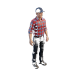

# Male Farmer (`peds_male_farmer`)

## Overview
- **Category**: `peds`
- **Item Identifier**: `peds_male_farmer`
- **Max Stack Size**: 1
- **Weight**: 75 kg
- **Base Economic Value**: $0
- **Consumable**: False

## Description
A young male farmer in modern work clothes - plaid shirt, work pants, boots, and a ball cap. Icon generated via Creative Claw following the project's item icon rules, then used as the reference image for Meshy AI image-to-3D (smart-topology model, t-pose for rigging, textured).

## 3D Model
- **Dimensions (m)**: `0.5 x 0.3 x 1.8`
- **Model**: `SKM_Peds_Male_Farmer.glb` (GLB)
- **Model**: `SKM_Peds_Male_Farmer_Rigged.glb` (GLB)
- **Model**: `SKM_Peds_Male_Farmer_Walk.fbx` (FBX)
- **Model**: `SKM_Peds_Male_Farmer_Run.fbx` (FBX)
- **Scale**: metric, 1 unit = 1 m. Ground-level pivot for placed things, centred pivot for handheld ones.

## Properties
- **Happiness modifier**: `0`
- **Thirst restore**: `0`
- **Energy restore**: `0`
- **Stamina restore**: `0`
- **Wellness modifier**: `0`

## Utilities
| Utility System | Usage / Output Metric | Operational Details |
| :--- | :--- | :--- |
| **Water** | `None (unplumbed / dry)` | None (unplumbed / dry) |
| **Electricity** | `None (passive / unpowered)` | None (passive / unpowered) |
| **Sewage / Waste** | `None (no waste discharge)` | None (no waste discharge) |
| **Battery Power** | `None (no internal battery)` | None (no internal battery) |
| **Internet / Data** | `None (offline / non-networked)` | None (offline / non-networked) |

## Asset Files
- **3D Model (FBX)**: [SKM_Peds_Male_Farmer.fbx](SKM_Peds_Male_Farmer.fbx)
- **3D Model (GLB)**: [SKM_Peds_Male_Farmer.glb](SKM_Peds_Male_Farmer.glb)
- **3D Model (FBX)**: [SKM_Peds_Male_Farmer_Rigged.fbx](SKM_Peds_Male_Farmer_Rigged.fbx)
- **3D Model (GLB)**: [SKM_Peds_Male_Farmer_Rigged.glb](SKM_Peds_Male_Farmer_Rigged.glb)
- **3D Model (FBX)**: [SKM_Peds_Male_Farmer_Run.fbx](SKM_Peds_Male_Farmer_Run.fbx)
- **3D Model (FBX)**: [SKM_Peds_Male_Farmer_Walk.fbx](SKM_Peds_Male_Farmer_Walk.fbx)
- **Icon (PNG)**: [SKM_Peds_Male_Farmer_base_color.png](SKM_Peds_Male_Farmer_base_color.png)
- **Plugin Manifest (JSON)**: [peds_male_farmer.json](peds_male_farmer.json)
- **Icon (PNG)**: [peds_male_farmer.png](peds_male_farmer.png)
