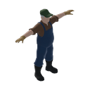

# Old Farmer (`peds_old_farmer`)

## Overview
- **Category**: `peds`
- **Item Identifier**: `peds_old_farmer`
- **Weight**: 72.0 kg
- **Consumable**: False

## Description
An elderly male farmer in modern work clothes - denim bib overalls, a plaid work shirt, work boots, work gloves and a green ball cap; weathered face, grey beard, slightly stooped.

## Generation Pipeline
- **Reference image**: Meshy text-to-image (`nano-banana-pro`), t-pose, low-poly 3D game asset style.
- **3D Model + Texture**: Meshy image-to-3D, `model_type='smart-topology'` (`ai_model='meshy-t2'`), `target_polycount=4000` - landed at 4027 raw triangles, no decimation needed.
- **Rigging**: Meshy AI rigging (`meshy_rig`), 1.75m height, includes free Walk and Run animation clips (FBX, skinned).
- Total cost: 29 credits (9 image + 15 mesh/texture + 5 rig+animations).

## 3D Model & Mesh Specifications
- **Rest Pose**: T-pose, rigged for Unity Mecanim Humanoid.
- **Shading Aesthetic**: 3D Low-Poly Faceted, Metric Scale, ~1.75m height.
- **Icon**: rendered from the unrigged base model via tools/render_icon_from_model.py

## Utilities & Resource Profile
| Utility System | Usage / Output Metric | Operational Details |
| :--- | :--- | :--- |
| **💧 Water** | `None (unplumbed / dry)` | None (unplumbed / dry) |
| **⚡ Electricity** | `None (passive / unpowered)` | None (passive / unpowered) |
| **🚽 Sewage / Waste** | `None (no waste discharge)` | None (no waste discharge) |
| **🔋 Battery Power** | `None (no internal battery)` | None (no internal battery) |
| **🌐 Internet / Data** | `None (offline / non-networked)` | None (offline / non-networked) |

## Asset Files & Links
- **Plugin Manifest (JSON)**: [peds_old_farmer.json](peds_old_farmer.json)
- **Icon (PNG)**: [peds_old_farmer.png](peds_old_farmer.png)
- **3D Mesh, unrigged base (GLB)**: [peds_old_farmer.glb](peds_old_farmer.glb)
- **3D Mesh, rigged (GLB)**: [peds_old_farmer_Rigged.glb](peds_old_farmer_Rigged.glb)
- **3D Mesh, rigged (FBX)**: [peds_old_farmer_Rigged.fbx](peds_old_farmer_Rigged.fbx)
- **Walk animation (FBX)**: [peds_old_farmer_Walk.fbx](peds_old_farmer_Walk.fbx)
- **Run animation (FBX)**: [peds_old_farmer_Run.fbx](peds_old_farmer_Run.fbx)
