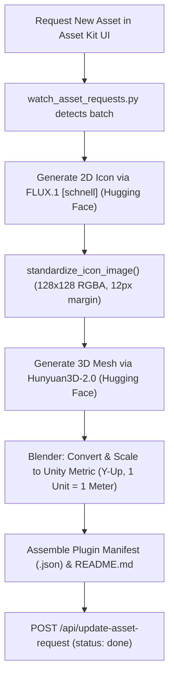

# Homesteader Asset Generation & Unity Pipeline Guide (100% Free Stack)

> **FOR ALL AGENTS (Claude, Gemini, etc.) WORKING ON HOMESTEADER:**
>
> 1. **Engine Target**: We have officially switched from Unreal Engine to **Unity (Unity 6 / 6000.x)**.
> 2. **Generation Pipeline Policy**: The **100% Free Stack** below is the **DEFAULT**. Paid services (CreativeClaw, Meshy.ai) are an explicit **opt-in per request** - only use them for items marked `PIPELINE=paid`, and confirm the credit cost with the user first (see `PAID_ITEM_PIPELINE` in `assets/watch_asset_requests.py`).
> 3. **100% Free Stack**:
>    - **2D Concept Icons**: **FLUX.1 [schnell]** on Hugging Face Spaces (or Google AI Studio free tier / Pollinations.ai) $\rightarrow$ **$0**.
>    - **Icon Standardization**: Outside-in flood fill to **128×128 32-bit RGBA** with 12px margin $\rightarrow$ **$0**.
>    - **3D Mesh Generation**: **Tencent Hunyuan3D-2.0** on Hugging Face Spaces $\rightarrow$ **$0**.
>    - **Conversion & Formatting**: Blender headless background script (GLB $\rightarrow$ Unity FBX + textures) $\rightarrow$ **$0**.
>    - **Rigging & Animations**: Blender **Mixamo Addon** for Humanoids (`bl_ext.blender_org.mixamo_rig`) & Blender Armature for Quadrupeds $\rightarrow$ **$0**.
>
> Helper module: `assets/free_generator.py` contains ready-to-run functions for every step!

---

## 1. Engine Specifications (Unity 6)

| Parameter             | Value / Standard                     | Notes                                                                             |
| :-------------------- | :----------------------------------- | :-------------------------------------------------------------------------------- |
| **Engine**            | **Unity 6 (6000.6.0f1)**             | Active editor running in project.                                                 |
| **World Scale**       | **1 Unit = 1 Meter**                 | Unreal was 1 unit = 1 cm. Unity is 1 unit = 1 meter.                              |
| **Coordinate System** | **$Y$-Up, $+Z$-Forward, $+X$-Right** | Left-handed. Blender export handles this with `axis_forward='-Z'`, `axis_up='Y'`. |
| **Character Rigging** | **Unity Mecanim (Humanoid)**         | Fully compatible with Mixamo rigs (`bl_ext.blender_org.mixamo_rig` in Blender).   |
| **Model Formats**     | **`.fbx` or `.glb` / `.obj`**        | Meshes are stored in `assets/<category>/<item_id>/` with textures.                |
| **2D UI Icons**       | **128×128 px 32-bit RGBA PNG**       | Imported as `Sprite (2D and UI)` for Canvas and Inventory HUD.                    |

---

## 2. The 100% Free Generation Pipeline



### Step 1: 2D Icon Generation (Replaces CreativeClaw)

Default path - use `free_generator.generate_icon_flux()` or the Hugging Face Space directly. (CreativeClaw is only used for items explicitly marked `PIPELINE=paid`.)

```python
from gradio_client import Client

client = Client("black-forest-labs/FLUX.1-schnell")
result = client.predict(
    prompt="A 3D low-poly faceted render of [ITEM_NAME], [DESCRIPTION]. Solid uniform background #2b3442, isometric 3/4 front view, floating in empty space.",
    width=1024,
    height=1024,
    num_inference_steps=4,
    api_name="/infer"
)
# result[0] is the local path to the generated 1024x1024 image
```

_Rule Reminder_: Directional items (animals, vehicles, tools) must face **toward the LEFT** of the frame.

### Step 2: Icon Standardization (HUD Rules)

Always run the raw render through `assets/regen_icons.py`:

```python
import regen_icons

# Performs outside-in flood fill, tight bounding box crop, Lanczos scale to <= 104px,
# and centers on 128x128 canvas with 100% perimeter alpha = 0.
ok, msg = regen_icons.standardize_icon_image(raw_render_path, target_icon_path)
```

### Step 3: 3D Model Generation (Replaces Meshy.ai)

Use Tencent's **Hunyuan3D-2.0** Hugging Face Space. `gradio_client` is already installed and verified:

```python
from gradio_client import Client, handle_file

client = Client("tencent/Hunyuan3D-2")

# 1. Generate 3D shape and texture from standardized icon
gen = client.predict(
    caption="low poly game asset",
    image=handle_file(icon_path),
    steps=30,
    guidance_scale=5.0,
    octree_resolution=256,
    check_box_rembg=True,
    api_name="/generation_all"
)

# 2. Export clean textured GLB
export = client.predict(
    file_out=gen[0],
    file_out2=gen[1],
    file_type="glb",
    reduce_face=True,
    export_texture=True,
    target_face_num=8000,
    api_name="/on_export_click"
)
# download file is in export[1]["path"]
```

### Step 4: Unity Export & Formatting (Blender)

Run Blender headlessly (or via Blender MCP `execute_blender_code` / `export_scene`):

- Ensure metric scale (1 Unit = 1 Meter).
- Pivot aligned to the bottom ($Z_{min} = 0$) for placed structures/crops, or centered for tools/items.
- Export as `.fbx` (or keep `.glb` for Unity 6):
  ```python
  import free_generator as fg
  fg.convert_glb_to_unity_fbx("item.glb", "item.fbx")
  ```

---

## 3. Humanoid Rigging with Mixamo Addon in Blender

For all characters in `assets/peds/` or humanoid NPCs:

1. Blender has the official **Mixamo Rig Addon** (`bl_ext.blender_org.mixamo_rig`) installed and enabled.
2. In Python/Blender MCP:
   ```python
   # Select character armature:
   bpy.ops.mr.make_rig(ik_arms=True, ik_legs=True)  # Builds control rig
   bpy.ops.mr.import_anim_to_rig()                   # Imports Walk/Run animations
   bpy.ops.mr.bake_anim()                            # Bakes to deform skeleton
   ```
3. Export animations as:
   - `<item_id>_Walk.fbx`
   - `<item_id>_Run.fbx`
4. In Unity, set **Animation Type** to `Humanoid` on the imported FBX. Mecanim auto-maps all bones effortlessly.

---

## 4. Quadruped / Non-Humanoid Rigging

For animals (cows, goats, sheep, dogs, pigs, horses):

1. Use the standard 19-bone quadruped armature (`root`, `spine_pelvis`, `spine_chest`, `neck`, `head`, `tail_01..02`, and 4 leg chains: `upper`, `lower`, `paw`).
2. Parent with `ARMATURE_AUTO` (automatic weights).
3. Bake 24-frame trot **Walk** cycle and 16-frame gallop **Run** cycle.
4. Export as `<item_id>_Walk.fbx` and `<item_id>_Run.fbx`.

---

## 5. Asset Kit Queue & Watcher Updates

When processing batches queued in `assets/_asset_requests/`:

1. Mark request in progress:
   ```python
   POST /api/update-asset-request {"id": req_id, "status": "in_progress", "step": "Generating 3D mesh via Hunyuan3D-2 (Free)"}
   ```
2. Mark request done when complete:
   ```python
   POST /api/update-asset-request {
       "id": req_id,
       "status": "done",
       "item_id": item_id,
       "step": "Done - generated via free FLUX + Hunyuan3D-2 pipeline",
       "credits_used": {"creative_claw": 0, "meshy": 0}
   }
   ```
3. Run `python update_catalog_readme.py` to synchronize the master index.
