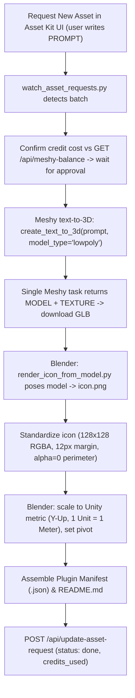

# Homesteader Asset Generation & Unity Pipeline Guide (Meshy text-to-3D)

> **FOR ALL AGENTS (Claude, Gemini, etc.) WORKING ON HOMESTEADER:**
>
> 1. **Engine Target**: We have officially switched from Unreal Engine to **Unity (Unity 6 / 6000.x)**.
> 2. **Generation Pipeline Policy**: **There is no free pipeline any more — everything costs money.** The 100% Free Stack (FLUX.1 [schnell] + Tencent Hunyuan3D-2.0) and `tools/free_generator.py` are **RETIRED**. Do not call them, do not offer them.
> 3. **The one and only pipeline**:
>    - **3D Model + Texture**: **Meshy text-to-3D** (`tools/meshy_client.py` -> `create_text_to_3d()`) → returns the model **and its texture** →
>    - **Icon**: rendered **FROM that model** in Blender (`tools/render_icon_from_model.py`) and standardized to 128×128 RGBA →
>    - **Formatting**: Blender headless (scale to metric, set pivot, textures embedded) →
>    - **Rigging & Animations** (free): Blender **Mixamo Addon** for Humanoids (`bl_ext.blender_org.mixamo_rig`) & Blender Armature for Quadrupeds.
> 4. **LOW POLY IS MANDATORY, ALWAYS, NO EXCEPTIONS**: `model_type='lowpoly'` on every generation. Never `standard`, never `smart-topology`.
>
> **Cost confirmation is mandatory before spending.** Check `GET /api/meshy-balance`, present the estimated cost and the resulting balance, and wait for explicit approval. A user passing a prompt is not approval of a specific spend.

---

## 1. Engine Specifications (Unity 6)

| Parameter             | Value / Standard                     | Notes                                                                             |
| :-------------------- | :----------------------------------- | :-------------------------------------------------------------------------------- |
| **Engine**            | **Unity 6 (6000.6.0f1)**             | Active editor running in project.                                                 |
| **World Scale**       | **1 Unit = 1 Meter**                 | Unreal was 1 unit = 1 cm. Unity is 1 unit = 1 meter.                              |
| **Coordinate System** | **$Y$-Up, $+Z$-Forward, $+X$-Right** | Left-handed. Blender export handles this with `axis_forward='-Z'`, `axis_up='Y'`. |
| **Character Rigging** | **Unity Mecanim (Humanoid)**         | Fully compatible with Mixamo rigs (`bl_ext.blender_org.mixamo_rig` in Blender).   |
| **Model Formats**     | **`.glb` (default)** / `.fbx` rigged only | Meshes are stored in `assets/<category>/<item_id>/` with textures.                |
| **2D UI Icons**       | **128×128 px 32-bit RGBA PNG**       | Imported as `Sprite (2D and UI)` for Canvas and Inventory HUD.                    |

---

## 2. The Meshy Generation Pipeline



### Step 1: The user's prompt is the input

A request carries a `PROMPT='...'` marker written by the user. That text is **explicit direction on what to make**.

- Pass it to Meshy **as-is**.
- **Append** the standing technical rules so it generates properly (low-poly, modern, faceted styling, external view where relevant).
- **Never rewrite, replace or paraphrase the user's intent.**

```python
# user_prompt is the PROMPT='...' text from the request, verbatim.
prompt = f"{user_prompt}, low-poly game asset, modern, faceted low-poly styling"
```

### Step 2: Cost confirmation (MANDATORY)

Nothing is generated before this happens. Do not skip it because the user already submitted a request — submitting a prompt is not the same as approving a specific spend.

```python
import sys
sys.path.append(r"C:\Users\casey\Desktop\Homesteader\tools")
import meshy_client as mc

balance_before = mc.get_balance()   # also available as GET /api/meshy-balance
# Present: estimated cost (meshy credits) + resulting balance. WAIT FOR APPROVAL.
```

### Step 3: Meshy text-to-3D (model + texture in one task)

`tools/meshy_client.py` -> `create_text_to_3d()` is the **only** generation entry point.

```python
import meshy_client as mc

# LOW POLY IS MANDATORY, ALWAYS, NO EXCEPTIONS.
preview_id = mc.create_text_to_3d(prompt, ai_model="meshy-6", model_type="lowpoly")

# Poll until the preview finishes, then run the refine pass to apply the texture.
refine_id = mc.create_text_to_3d_refine(preview_id)
# Poll get_task('text-to-3d', refine_id) and download the GLB from the result.
```

- The single Meshy task returns the **model AND its texture** — there is no separate texturing step and no separate 2D concept image.
- Download the **GLB** (GLB is the project's model format, textures embedded).

### Step 4: Render the icon FROM the model

There is **no separate 2D icon generation step**. The icon is always rendered from the finished textured model:

```bash
python tools/render_icon_from_model.py <model_path> assets/<category>/<item_id>/<item_id>.png
```

- Poses the textured model in Blender (isometric 3/4 front view).
- Renders with top-left key lighting.
- **Tool pose**: a long-handled tool is drawn on a DIAGONAL (~35–45°) with the HANDLE at the upper-right and the WORKING END (blade/share/head) at the lower-left — exactly like `assets/tools/tool_shovel_trenching/tool_shovel_trenching.png`. The model's own front axis is arbitrary, so **ALWAYS open the result**: if the working end is not lower-left, re-run with the other `face_left` value and keep the one that matches.
- **Direction is not optional**: directional items (animals, vehicles, tools) MUST face toward the LEFT of the frame.
- **External view only**: buildings and objects must show the complete outer facade/walls/roof — no internal structure, no cutaways, no indoor camera perspective.
- **Standardize** to Homesteader Icon Standards (128×128 px, 32-bit RGBA, ≤ 104 px max dimension, ≥ 12 px margin, 100% outer perimeter alpha = 0, no borders) via `assets/regen_icons.py` `standardize_icon_image()`.

### Step 5: Unity Export & Formatting (Blender)

Run Blender headlessly (or via Blender MCP `execute_blender_code` / `export_scene`):

- Ensure metric scale (1 Unit = 1 Meter).
- Pivot aligned to the bottom ($Z_{min} = 0$) for placed structures/crops, or centered for tools/items.
- Keep it as **`.glb`** (the project standard; textures embedded, loaded at runtime by glTFast).
- FBX is only for rigged/animated models that need Unity Humanoid/Generic animation.

---

## 3. Humanoid Rigging with Mixamo Addon in Blender

Rigging is **free** (no credits) and integrates natively with Unity Mecanim. For all characters in `assets/peds/` or humanoid NPCs:

1. Blender has the official **Mixamo Rig Addon** (`bl_ext.blender_org.mixamo_rig`) installed and enabled.
2. In Python/Blender MCP:
   ```python
   # Select character armature:
   bpy.ops.mr.make_rig(ik_arms=True, ik_legs=True)  # Builds control rig
   bpy.ops.mr.import_anim_to_rig()                   # Imports Walk/Run animations
   bpy.ops.mr.bake_anim()                            # Bakes to deform skeleton
   ```
3. Export animations as:
   - `<item_id>_Walk.fbx`
   - `<item_id>_Run.fbx`
4. In Unity, set **Animation Type** to `Humanoid` on the imported FBX. Mecanim auto-maps all bones effortlessly.

---

## 4. Quadruped / Non-Humanoid Rigging

For animals (cows, goats, sheep, dogs, pigs, horses):

1. Use the standard 19-bone quadruped armature (`root`, `spine_pelvis`, `spine_chest`, `neck`, `head`, `tail_01..02`, and 4 leg chains: `upper`, `lower`, `paw`).
2. Parent with `ARMATURE_AUTO` (automatic weights).
3. Bake 24-frame trot **Walk** cycle and 16-frame gallop **Run** cycle.
4. Export as `<item_id>_Walk.fbx` and `<item_id>_Run.fbx`.

**STANDING RULE, NO EXCEPTIONS**: rig EVERY `RIG_TYPE` in Blender (Mixamo Addon for humanoids, Animal Animator for quadrupeds/creatures). Rigging is free.

---

## 5. Asset Kit Queue & Watcher Updates

When processing batches queued in `assets/_asset_requests/`:

1. Mark request in progress:
   ```python
   POST /api/update-asset-request {"id": req_id, "status": "in_progress", "step": "Generating 3D model via Meshy text-to-3D (lowpoly)"}
   ```
2. Mark request done when complete, reporting the credits actually spent:
   ```python
   POST /api/update-asset-request {
       "id": req_id,
       "status": "done",
       "item_id": item_id,
       "step": "Done - generated via Meshy text-to-3D (lowpoly), icon rendered from model",
       "credits_used": {"creative_claw": 0, "meshy": 15}
   }
   ```
3. Run `python update_catalog_readme.py` to synchronize the master index.
